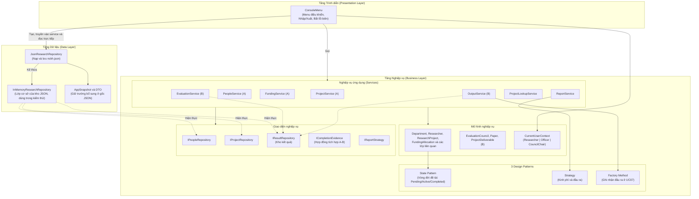
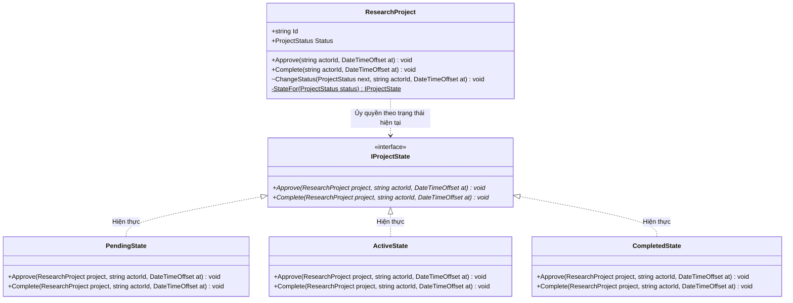
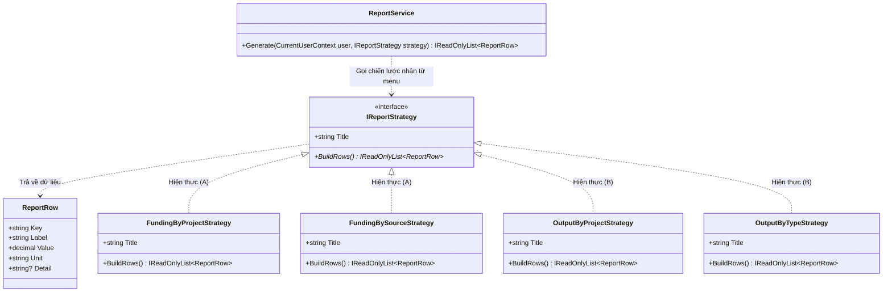
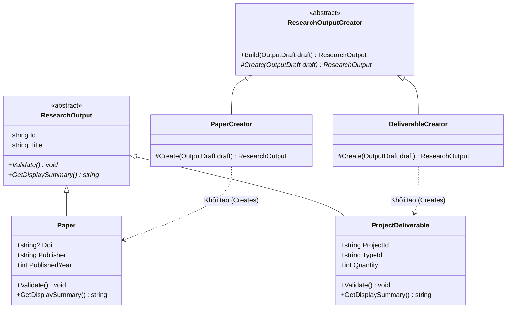
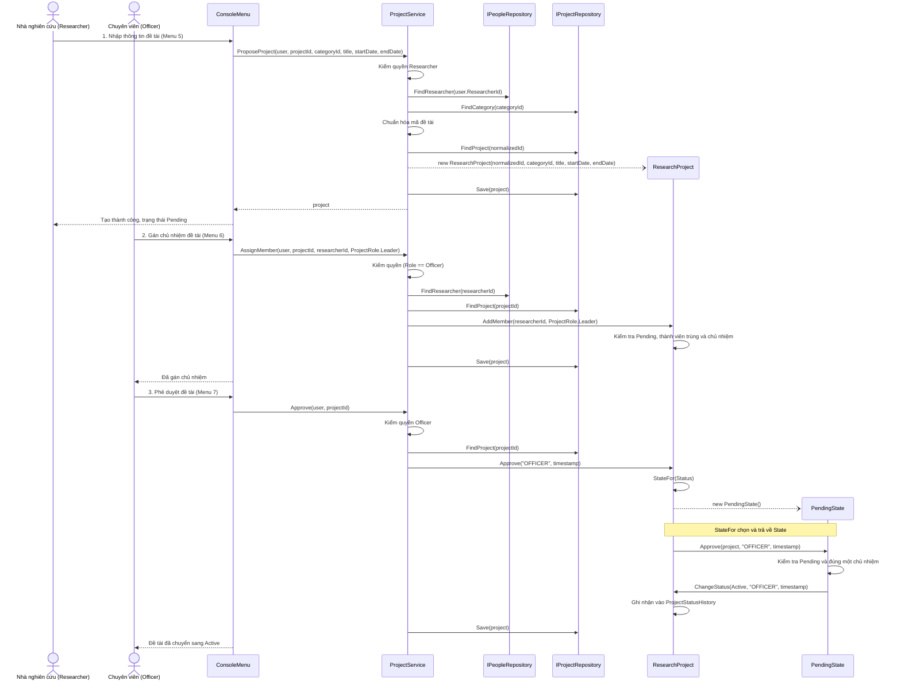
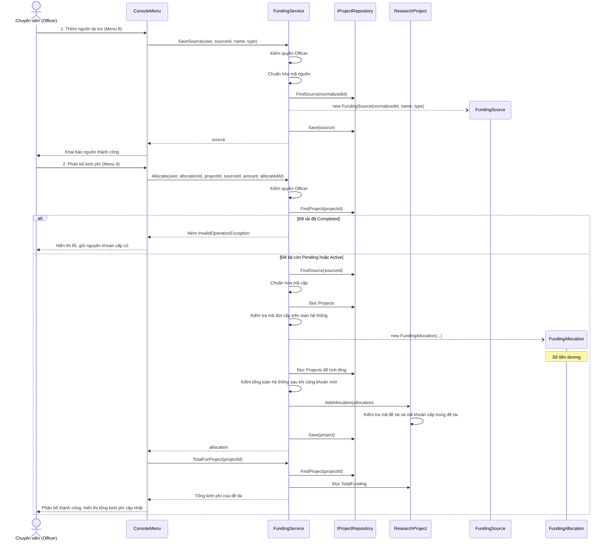
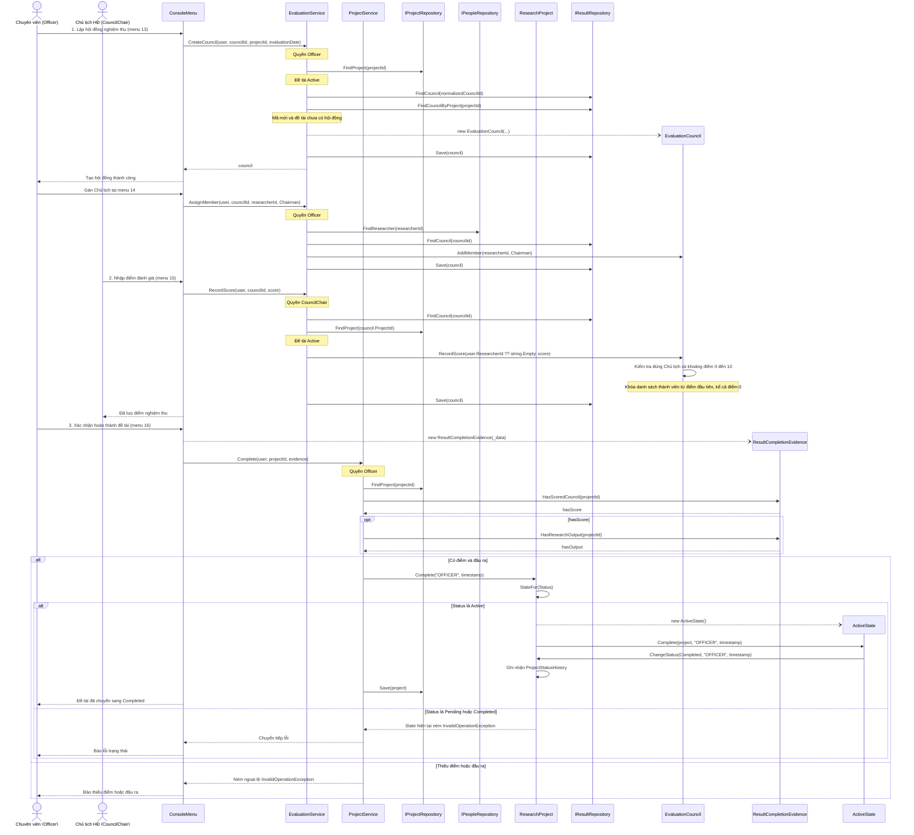
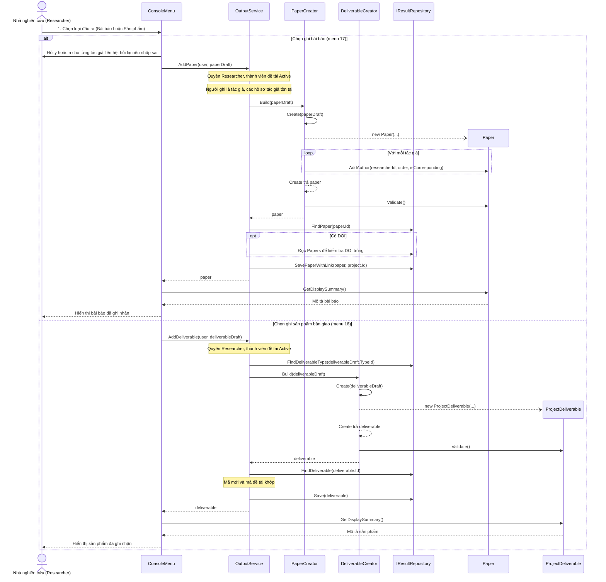

# Sơ đồ UML hệ thống quản lý nghiên cứu khoa học ở đại học

## 1. Kiến trúc ba tầng

Các sơ đồ trình bày cấu trúc của bản tích hợp và bốn luồng nghiệp vụ tiêu biểu. Xem đủ tám ca sử dụng trong [đặc tả nghiệp vụ](scope.md) và [README](../README.md).

Chương trình C# gồm ba tầng trong cùng project. Hình dưới là sơ đồ khối kiến trúc. Quan hệ lớp và giao diện kho dùng ký pháp UML ở mục 4.

- **Presentation.** `ConsoleMenu` nhận lựa chọn và dữ liệu nhập, giữ vai trò hiện tại, gọi service và hiển thị kết quả hoặc lỗi. Menu khởi tạo kho JSON, truyền kho vào service và đọc trực tiếp một số dữ liệu để hiển thị.
- **Business.** Chứa mô hình, service, các giao diện và `CurrentUserContext`. Xử lý quy tắc nghiệp vụ mà không đọc hoặc ghi console, tệp dữ liệu.
- **Data.** `InMemoryResearchRepository` hiện thực ba giao diện kho. `JsonResearchRepository` kế thừa lớp này và ghi đè các thao tác lưu để ghi `data/nckh.json`. Các ca nghiệp vụ dùng kho trong bộ nhớ. Nhóm ca nạp JSON mở ứng dụng với tệp dữ liệu riêng trong thư mục tạm.

---

## 2. Sơ đồ lớp nghiệp vụ

Thiết kế tổng thể có 16 kiểu nghiệp vụ cụ thể, gồm 9 kiểu về nhân sự, đề tài, kinh phí và 7 kiểu về nghiệm thu, đầu ra. `ProjectStatusHistory` là record thuộc nhóm A. `ResearchOutput` là lớp trừu tượng cho phần đầu ra. Bội số tác giả và liên kết đề tài áp dụng cho bài báo hợp lệ đã lưu. `Paper` vừa được khởi tạo có thể chưa có tác giả.

### Các kiểu nghiệp vụ
1. **Dữ liệu nền**: `Department`, `Researcher`, `DepartmentHeadTerm`, `ProjectCategory`
2. **Đề tài**: `ResearchProject`, `ProjectParticipation`, `ProjectStatusHistory`
3. **Kinh phí**: `FundingSource`, `FundingAllocation`
4. **Nghiệm thu**: `EvaluationCouncil`, `CouncilMembership`
5. **Đầu ra**: `DeliverableType`, `ProjectDeliverable`, `Paper`, `PaperAuthor`, `ProjectPaperLink`

```mermaid
classDiagram
    %% Lớp cơ sở trừu tượng
    class ResearchOutput {
        <<abstract>>
        +string Id
        +string Title
        +Validate()* void
        +GetDisplaySummary()* string
    }

    %% Dữ liệu nền và nhân sự (A)
    class Department {
        +string Id
        +string Name
        +DateOnly CreatedAt
        +Rename(string name) void
    }

    class Researcher {
        +string Id
        +string DepartmentId
        +string FullName
        +string Email
        +string? AcademicTitle
        +string? Phone
        +string? Organization
        +bool IsInstructor
        +Update(...) void
    }

    class DepartmentHeadTerm {
        +string Id
        +string DepartmentId
        +string ResearcherId
        +DateOnly From
        +DateOnly? To
    }

    class ProjectCategory {
        +string Id
        +string Name
    }

    %% Đề tài và kinh phí (A)
    class ResearchProject {
        +string Id
        +string CategoryId
        +string Title
        +DateOnly StartDate
        +DateOnly? EndDate
        +ProjectStatus Status
        +IReadOnlyList~ProjectParticipation~ Members
        +IReadOnlyList~FundingAllocation~ Allocations
        +IReadOnlyList~ProjectStatusHistory~ History
        +decimal TotalFunding
        +AddMember(string researcherId, ProjectRole role) void
        +AddAllocation(FundingAllocation allocation) void
        +Approve(string actorId, DateTimeOffset at) void
        +Complete(string actorId, DateTimeOffset at) void
        ~ChangeStatus(ProjectStatus next, string actorId, DateTimeOffset at) void
    }

    class ProjectParticipation {
        +string ProjectId
        +string ResearcherId
        +ProjectRole Role
    }

    class ProjectStatusHistory {
        <<record>>
        +string ProjectId
        +ProjectStatus FromStatus
        +ProjectStatus ToStatus
        +DateTimeOffset ChangedAt
        +string ActorId
    }

    class FundingSource {
        +string Id
        +string Name
        +string Type
    }

    class FundingAllocation {
        +string Id
        +string ProjectId
        +string SourceId
        +decimal Amount
        +DateOnly AllocatedAt
    }

    %% Nghiệm thu (B)
    class EvaluationCouncil {
        +string Id
        +string ProjectId
        +DateOnly EvaluationDate
        +decimal? Score
        +IReadOnlyList~CouncilMembership~ Members
        +AddMember(string researcherId, CouncilRole role) void
        +RecordScore(string actorResearcherId, decimal score) void
    }

    class CouncilMembership {
        +string CouncilId
        +string ResearcherId
        +CouncilRole Role
    }

    %% Đầu ra nghiên cứu (B)
    class DeliverableType {
        +string Id
        +string Name
    }

    class ProjectDeliverable {
        +string ProjectId
        +string TypeId
        +int Quantity
        +Validate() void
        +GetDisplaySummary() string
    }

    class Paper {
        +string? Doi
        +string Publisher
        +int PublishedYear
        +IReadOnlyList~PaperAuthor~ Authors
        +AddAuthor(string researcherId, int order, bool isCorresponding) void
        +Validate() void
        +GetDisplaySummary() string
    }

    class PaperAuthor {
        +string PaperId
        +string ResearcherId
        +int AuthorOrder
        +bool IsCorresponding
    }

    class ProjectPaperLink {
        +string ProjectId
        +string PaperId
    }

    %% Quan hệ Kế thừa (Inheritance)
    ResearchOutput <|-- ProjectDeliverable : Kế thừa (Generalization)
    ResearchOutput <|-- Paper : Kế thừa (Generalization)

    %% Liên kết qua mã và quan hệ sở hữu danh sách
    Department "1" <-- "0..*" Researcher : Trực thuộc
    Department "1" <-- "0..*" DepartmentHeadTerm : Lịch sử nhiệm kỳ
    Researcher "1" <-- "0..*" DepartmentHeadTerm : Lãnh đạo

    ProjectCategory "1" <-- "0..*" ResearchProject : Thuộc loại

    ResearchProject "1" *-- "0..*" ProjectParticipation : Danh sách thành viên
    ResearchProject "1" *-- "0..2" ProjectStatusHistory : Lịch sử trạng thái
    ResearchProject "1" -- "0..*" FundingAllocation : Các đợt cấp tiền

    Researcher "1" <-- "0..*" ProjectParticipation : Đảm nhiệm vai trò
    FundingSource "1" <-- "0..*" FundingAllocation : Nguồn cấp tiền

    %% Quan hệ Nghiệm thu
    ResearchProject "1" <-- "0..1" EvaluationCouncil : Tối đa 1 hội đồng
    EvaluationCouncil "1" *-- "0..*" CouncilMembership : Thành viên hội đồng
    Researcher "1" <-- "0..*" CouncilMembership : Tham gia hội đồng

    %% Quan hệ Đầu ra
    ResearchProject "1" <-- "0..*" ProjectDeliverable : Tham chiếu theo mã
    DeliverableType "1" <-- "0..*" ProjectDeliverable : Phân loại sản phẩm

    Paper "1" *-- "1..*" PaperAuthor : Tác giả bài báo
    Researcher "1" <-- "0..*" PaperAuthor : Là tác giả

    ResearchProject "1" <-- "0..*" ProjectPaperLink : Liên kết
    Paper "1" <-- "1..*" ProjectPaperLink : Liên kết của bài đã lưu
```

---

## 3. Mẫu thiết kế

- **Thành viên A.** State cho vòng đời đề tài và hai Strategy tổng hợp kinh phí.
- **Thành viên B.** Factory Method và Strategy về đầu ra cho UC07 và UC08.

### 3.1. State cho vòng đời đề tài
- `ResearchProject.StateFor` chọn State theo trạng thái hiện tại. `PendingState` duyệt đề tài đang chờ có đúng một chủ nhiệm, `ActiveState` hoàn thành đề tài đang thực hiện, còn `CompletedState` từ chối cả hai thao tác.
- Khi thêm trạng thái, cần bổ sung lớp State, cập nhật `ProjectStatus`, `StateFor` và quy tắc phục hồi lịch sử từ JSON.

### 3.2. Strategy cho báo cáo
- Bốn báo cáo dùng chung `IReportStrategy` và kiểu dòng `ReportRow`. `ReportService.Generate` kiểm quyền chuyên viên rồi gọi `BuildRows()` của Strategy được menu chọn.
- **Đã cài đặt ở phần A**
  - `FundingByProjectStrategy`: Tổng hợp kinh phí theo từng đề tài.
  - `FundingBySourceStrategy`: Nhóm các đợt cấp theo nguồn và cộng tiền cho từng nhóm. Nguồn chưa cấp kinh phí không xuất hiện trong bảng.
- **Phân hệ B**
  - `OutputByProjectStrategy`: Đếm bản ghi bài báo và sản phẩm liên kết với từng đề tài.
  - `OutputByTypeStrategy`: Đếm bài báo và cộng số lượng bàn giao theo loại sản phẩm.

### 3.3. Factory Method cho UC07

`ResearchOutputCreator` cung cấp `Build(OutputDraft)`, gọi phương thức trừu tượng `Create(OutputDraft)` rồi gọi `Validate()` trên đối tượng vừa tạo. Hai lớp con ghi đè phương thức để tạo `Paper` hoặc `ProjectDeliverable`. Đầu ra kiểm tra dữ liệu của chính nó. Các điều kiện cần tra kho, như DOI trùng hoặc mã loại sản phẩm không tồn tại, thuộc trách nhiệm của service.

---

## 4. Service và giao diện kho dữ liệu

Service nhận các giao diện kho qua constructor. Đường liền tới giao diện kho biểu diễn tham chiếu được giữ trong đối tượng. Menu 16 tạo `ResultCompletionEvidence` trên kho thật. `ProjectService.Complete` nhận `ICompletionEvidence` từ bên gọi. Bộ kiểm thử A dùng một đối tượng giả lập giao diện này. Cài đặt thật gọi `FindCouncilByProject` để kiểm điểm và dùng `ResultQueries.OutputsOf` để tra bài báo đã liên kết cùng các sản phẩm bàn giao.

```mermaid
classDiagram
    %% Repositories
    class IPeopleRepository {
        <<interface>>
        +FindDepartment(string id) Department?
        +FindResearcher(string id) Researcher?
        +IReadOnlyCollection~Researcher~ Researchers
        +IReadOnlyCollection~DepartmentHeadTerm~ HeadTerms
        +Save(Department department) void
        +Save(Researcher researcher) void
    }

    class IProjectRepository {
        <<interface>>
        +FindCategory(string id) ProjectCategory?
        +FindProject(string id) ResearchProject?
        +FindSource(string id) FundingSource?
        +IReadOnlyCollection~ResearchProject~ Projects
        +Save(ResearchProject project) void
        +Save(FundingSource source) void
    }

    class IResultRepository {
        <<interface>>
        +FindCouncil(string id) EvaluationCouncil?
        +FindCouncilByProject(string projectId) EvaluationCouncil?
        +FindPaper(string id) Paper?
        +FindDeliverable(string id) ProjectDeliverable?
        +FindDeliverableType(string id) DeliverableType?
        +IReadOnlyCollection~ProjectPaperLink~ PaperLinks
        +IReadOnlyCollection~ProjectDeliverable~ Deliverables
        +Save(EvaluationCouncil council) void
        +Save(Paper paper) void
        +SavePaperWithLink(Paper paper, string projectId) void
        +Save(ProjectDeliverable deliverable) void
    }

    class ICompletionEvidence {
        <<interface>>
        +HasScoredCouncil(string projectId) bool
        +HasResearchOutput(string projectId) bool
    }

    class IReportStrategy {
        <<interface>>
    }

    %% Services
    class PeopleService {
        +SaveDepartment(CurrentUserContext user, string id, string name, DateOnly createdAt) Department
        +SaveResearcher(CurrentUserContext user, string id, string departmentId, string fullName, string email, ...) Researcher
        +GetHeadHistory(CurrentUserContext user, string departmentId) IReadOnlyList~DepartmentHeadTerm~
    }

    class ProjectService {
        +ProposeProject(CurrentUserContext user, string id, string categoryId, string title, DateOnly startDate, DateOnly? endDate) ResearchProject
        +AssignMember(CurrentUserContext user, string projectId, string researcherId, ProjectRole role) void
        +Approve(CurrentUserContext user, string projectId) void
        +Complete(CurrentUserContext user, string projectId, ICompletionEvidence evidence) void
    }

    class FundingService {
        +SaveSource(CurrentUserContext user, string id, string name, string type) FundingSource
        +Allocate(CurrentUserContext user, string id, string projectId, string sourceId, decimal amount, DateOnly allocatedAt) FundingAllocation
        +TotalForProject(string projectId) decimal
    }

    class EvaluationService {
        +CreateCouncil(CurrentUserContext user, string id, string projectId, DateOnly evaluationDate) EvaluationCouncil
        +AssignMember(CurrentUserContext user, string councilId, string researcherId, CouncilRole role) void
        +RecordScore(CurrentUserContext user, string councilId, decimal score) void
    }

    class OutputService {
        +AddPaper(CurrentUserContext user, PaperDraft draft) Paper
        +AddDeliverable(CurrentUserContext user, DeliverableDraft draft) ProjectDeliverable
    }

    class ReportService {
        +Generate(CurrentUserContext user, IReportStrategy strategy) IReadOnlyList~ReportRow~
    }

    class ProjectLookupService {
        +Search(CurrentUserContext user, string? projectId, ProjectStatus? status) IReadOnlyList~ProjectSummary~
    }

    class ProjectSummary {
        <<record>>
    }

    class ResultCompletionEvidence {
        +HasScoredCouncil(string projectId) bool
        +HasResearchOutput(string projectId) bool
    }

    class InMemoryResearchRepository {
        +Save(Department value) void
        +Save(Researcher value) void
        +Save(ResearchProject value) void
        +Save(FundingSource value) void
    }

    class JsonResearchRepository {
        -string _dataPath
        -Load(AppSnapshot snapshot) void
        -Persist() void
    }

    %% Relationships
    PeopleService --> IPeopleRepository
    ProjectService --> IPeopleRepository
    ProjectService --> IProjectRepository
    ProjectService ..> ICompletionEvidence : Kiểm tra bằng chứng
    FundingService --> IProjectRepository
    EvaluationService --> IProjectRepository
    EvaluationService --> IPeopleRepository
    EvaluationService --> IResultRepository
    OutputService --> IPeopleRepository
    OutputService --> IResultRepository
    OutputService --> IProjectRepository
    ReportService ..> IReportStrategy

    InMemoryResearchRepository ..|> IPeopleRepository
    ResultCompletionEvidence ..|> ICompletionEvidence
    ResultCompletionEvidence --> IResultRepository
    ProjectLookupService --> IProjectRepository
    ProjectLookupService --> IResultRepository
    ProjectLookupService ..> ProjectSummary : Trả kết quả tra cứu
    InMemoryResearchRepository ..|> IResultRepository
    InMemoryResearchRepository ..|> IProjectRepository
    InMemoryResearchRepository <|-- JsonResearchRepository
```

---

## 5. Sơ đồ tuần tự

Bốn sơ đồ minh họa các luồng tiêu biểu. Hai sơ đồ đầu theo dõi UC02–UC03 và UC04 của A. Hai sơ đồ sau theo dõi UC05–UC06 và UC07 của B.

### 5.1. UC02–UC03 - Đề xuất, gán chủ nhiệm và duyệt
Luồng thành công gồm ba lệnh menu độc lập. Nhà nghiên cứu đề xuất đề tài, sau đó chuyên viên gán chủ nhiệm và duyệt đề tài.

### 5.2. UC04 - Khai báo nguồn và phân bổ kinh phí

Khai báo nguồn và phân bổ là hai lệnh menu độc lập. Lệnh 9 dùng một nguồn đã tồn tại. Sau khi tìm thấy đề tài, service kiểm tra trạng thái trước khi tạo khoản cấp. Đề tài đã hoàn thành giữ nguyên các khoản kinh phí đã lưu.

### 5.3. UC05–UC06 - Hội đồng và nghiệm thu

Các mục 13–16 là các lệnh menu độc lập. UC06a – Ghi điểm nghiệm thu thuộc Chủ tịch hội đồng khi đề tài đang `Active`. UC06b – Xác nhận hoàn thành thuộc Chuyên viên khi có điểm và ít nhất một đầu ra. Dịch vụ chỉ kiểm tra đầu ra sau khi biết hội đồng đã có điểm. Trạng thái được kiểm qua State sau khi kiểm đủ bằng chứng.

### 5.4. UC07 - Ghi nhận đầu ra qua Factory Method

Factory tạo đối tượng theo loại đầu ra. Sơ đồ minh họa hai lựa chọn menu ở luồng thành công. Menu 17 tạo liên kết đầu tiên khi ghi bài báo. Khi mở JSON, kho kiểm tra mỗi bài báo có ít nhất một liên kết và từ chối hội đồng hoặc đầu ra của đề tài `Pending`. Đầu ra hợp lệ đã lưu của đề tài `Completed` vẫn được nạp.

