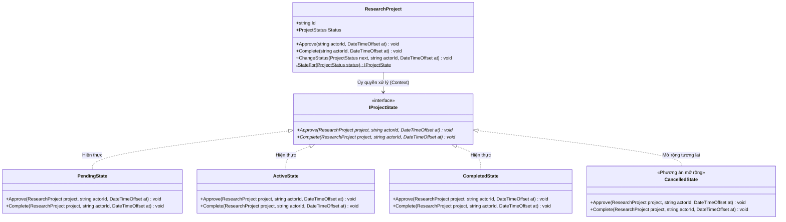
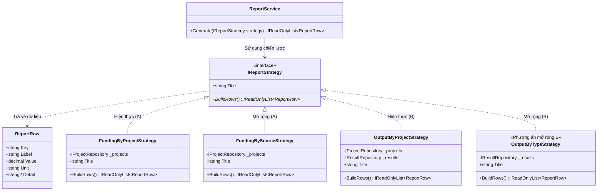
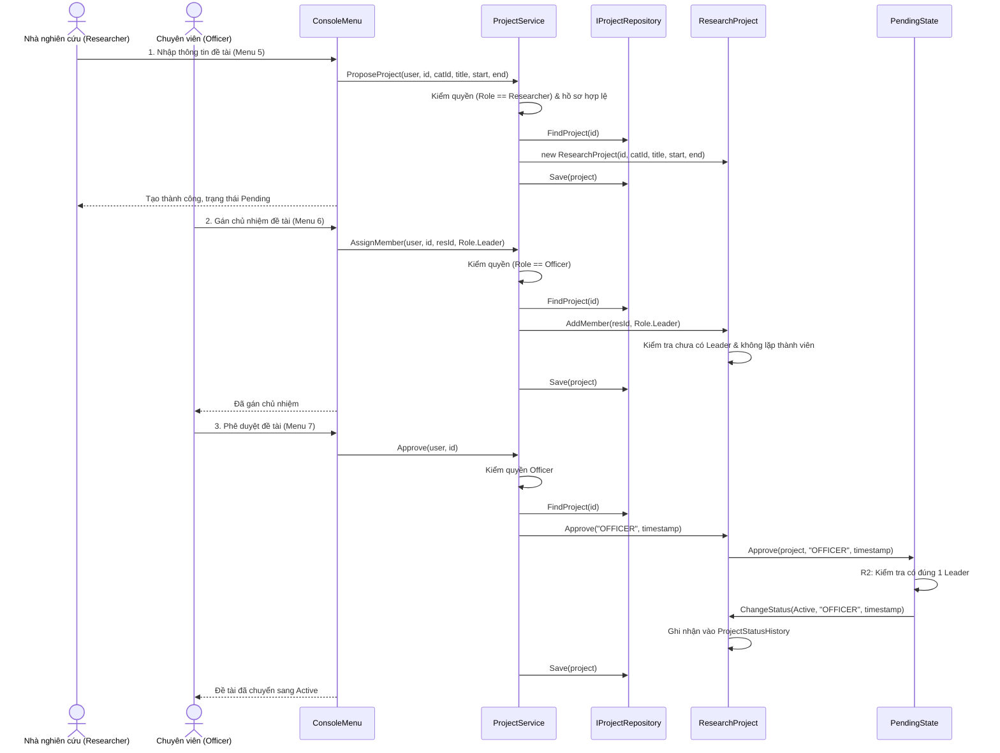
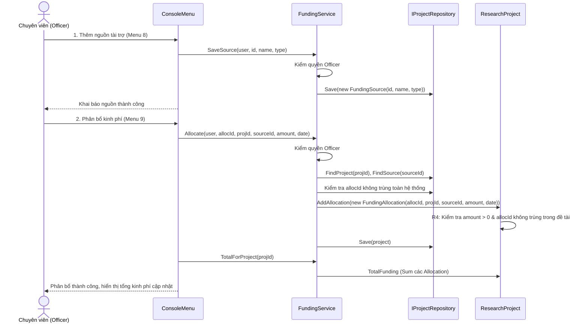
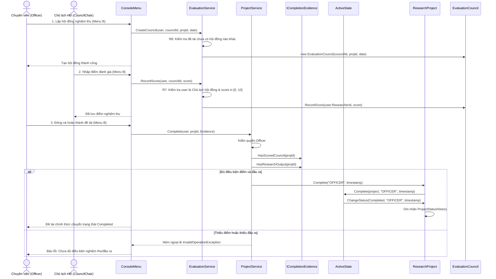
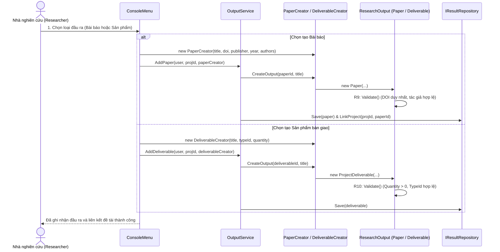

# Sơ đồ UML
## Hệ thống Quản lý Nghiên cứu Khoa học ở Đại học

---

## 1. Kiến trúc phân tầng tổng thể (3-Tier Architecture)

Hệ thống được tổ chức theo kiến trúc 3 tầng tách bạch (Namespace/Folder trong cùng 1 Project C#):
- **Presentation Layer**: Giao diện Console tương tác menu, bắt ngoại lệ ở biên người dùng, chuyển đổi dữ liệu nhập vào `CurrentUserContext` và gọi tầng nghiệp vụ.
- **Business Layer (Domain & Services)**: Chứa 16 thực thể lõi, lớp trừu tượng `ResearchOutput`, 3 Design Patterns (State, Strategy, Factory Method), 6 Service xử lý UC01–UC08 và các Interface Repository. Hoàn toàn không phụ thuộc vào `Console.ReadLine/WriteLine` hay thư viện I/O tệp.
- **Data Layer**: Hiện thực các Interface Repository thông qua `JsonResearchRepository` (đọc/ghi tệp `data/nckh.json` dựa trên DTO phẳng) và `InMemoryResearchRepository` (phục vụ Unit Test).

```mermaid
graph TD
    subgraph Presentation ["Tầng Trình diễn (Presentation Layer)"]
        UI["ConsoleMenu<br/>(Menu điều khiển, Nhập/Xuất, Bắt lỗi biên)"]
        CTX["CurrentUserContext<br/>(Researcher | Officer | CouncilChair)"]
    end

    subgraph Business ["Tầng Nghiệp vụ (Business Layer)"]
        subgraph Services ["Nghiệp vụ ứng dụng (Services)"]
            PS["ProjectService (A)"]
            PeoS["PeopleService (A)"]
            FS["FundingService (A)"]
            ES["EvaluationService (B)"]
            OS["OutputService (B)"]
            RS["ReportService (B)"]
        end

        subgraph Patterns ["3 Design Patterns"]
            StatePat["State Pattern<br/>(Vòng đời đề tài: Pending/Active/Completed)"]
            StratPat["Strategy Pattern<br/>(Báo cáo kinh phí & đầu ra: UC08)"]
            FactPat["Factory Method Pattern<br/>(Khởi tạo bài báo & sản phẩm: UC07)"]
        end

        subgraph DomainModels ["16 Thực thể Nghiệp vụ & Lớp trừu tượng"]
            Entities["Department, Researcher, ResearchProject,<br/>FundingAllocation, EvaluationCouncil, Paper, Deliverable..."]
        end

        subgraph RepoInterfaces ["Hợp đồng Lưu trữ (Repository Interfaces)"]
            IPeopleRepo["IPeopleRepository"]
            IProjectRepo["IProjectRepository"]
            IResultRepo["IResultRepository<br/>(Dự kiến phân hệ B)"]
            IEvidence["ICompletionEvidence<br/>(Hợp đồng tích hợp A-B)"]
        end
    end

    subgraph Data ["Tầng Dữ liệu (Data Layer)"]
        JsonRepo["JsonResearchRepository<br/>(Lưu trữ nckh.json an toàn)"]
        MemRepo["InMemoryResearchRepository<br/>(Phục vụ Unit Test độc lập)"]
        Snapshot["AppSnapshot & DTOs<br/>(Bảo toàn dữ liệu OtherModules)"]
    end

    UI --> Services
    UI --> CTX
    Services --> DomainModels
    Services --> Patterns
    Services --> RepoInterfaces
    JsonRepo ..|> IPeopleRepo
    JsonRepo ..|> IProjectRepo
    JsonRepo -.-|> IResultRepo
    MemRepo ..|> IPeopleRepo
    MemRepo ..|> IProjectRepo
    MemRepo -.-|> IResultRepo
    JsonRepo --> Snapshot
```

---

## 2. Sơ đồ UML Lớp Domain tổng thể (Domain Class Diagram)

Sơ đồ bao quát **16 thực thể cụ thể** của bài toán QL NCKH, bổ sung lớp trừu tượng `ResearchOutput`, lớp lịch sử trạng thái `ProjectStatusHistory`, và các lớp liên kết (Association Classes) quản lý quan hệ nhiều–nhiều có thuộc tính.

### Bảng phân loại 16 thực thể cụ thể:
1. **Dữ liệu nền**: `Department`, `Researcher`, `DepartmentHeadTerm`, `ProjectCategory`
2. **Đề tài**: `ResearchProject`, `ProjectParticipation`, `ProjectStatusHistory`
3. **Kinh phí**: `FundingSource`, `FundingAllocation`
4. **Nghiệm thu**: `EvaluationCouncil`, `CouncilMembership`
5. **Đầu ra**: `DeliverableType`, `ProjectDeliverable`, `Paper`, `PaperAuthor`, `ProjectPaperLink`
*(Cùng lớp trừu tượng `ResearchOutput` làm gốc đa hình cho Đầu ra)*

```mermaid
classDiagram
    %% Lớp cơ sở trừu tượng
    class ResearchOutput {
        <<abstract>>
        +string Id
        +string Title
        +Validate()* void
        +GetDisplaySummary()* string
    }

    %% Phân hệ 1: Dữ liệu nền & Nhân sự (A)
    class Department {
        +string Id
        +string Name
        +DateOnly CreatedAt
        +Rename(string name) void
    }

    class Researcher {
        +string Id
        +string DepartmentId
        +string FullName
        +string Email
        +string? AcademicTitle
        +string? Phone
        +string? Organization
        +bool IsInstructor
        +Update(...) void
    }

    class DepartmentHeadTerm {
        +string Id
        +string DepartmentId
        +string ResearcherId
        +DateOnly From
        +DateOnly? To
    }

    class ProjectCategory {
        +string Id
        +string Name
    }

    %% Phân hệ 2: Đề tài & Kinh phí (A)
    class ResearchProject {
        +string Id
        +string CategoryId
        +string Title
        +DateOnly StartDate
        +DateOnly? EndDate
        +ProjectStatus Status
        +IReadOnlyList~ProjectParticipation~ Members
        +IReadOnlyList~FundingAllocation~ Allocations
        +IReadOnlyList~ProjectStatusHistory~ History
        +decimal TotalFunding
        +AddMember(string researcherId, ProjectRole role) void
        +AddAllocation(FundingAllocation allocation) void
        +Approve(string actorId, DateTimeOffset at) void
        +Complete(string actorId, DateTimeOffset at) void
        ~ChangeStatus(ProjectStatus next, string actorId, DateTimeOffset at) void
    }

    class ProjectParticipation {
        +string ProjectId
        +string ResearcherId
        +ProjectRole Role
    }

    class ProjectStatusHistory {
        +string ProjectId
        +ProjectStatus FromStatus
        +ProjectStatus ToStatus
        +DateTimeOffset ChangedAt
        +string ActorId
    }

    class FundingSource {
        +string Id
        +string Name
        +string Type
    }

    class FundingAllocation {
        +string Id
        +string ProjectId
        +string SourceId
        +decimal Amount
        +DateOnly AllocatedAt
    }

    %% Phân hệ 3: Nghiệm thu (B)
    class EvaluationCouncil {
        +string Id
        +string ProjectId
        +DateOnly EvaluationDate
        +decimal? Score
        +IReadOnlyList~CouncilMembership~ Members
        +AddMember(string researcherId, CouncilRole role) void
        +RecordScore(string actorResearcherId, decimal score) void
    }

    class CouncilMembership {
        +string CouncilId
        +string ResearcherId
        +CouncilRole Role
    }

    %% Phân hệ 4: Đầu ra nghiên cứu (B)
    class DeliverableType {
        +string Id
        +string Name
    }

    class ProjectDeliverable {
        +string ProjectId
        +string TypeId
        +int Quantity
        +Validate() void
        +GetDisplaySummary() string
    }

    class Paper {
        +string Doi
        +string Publisher
        +int PublishedYear
        +IReadOnlyList~PaperAuthor~ Authors
        +AddAuthor(string researcherId, int order, bool isCorresponding) void
        +Validate() void
        +GetDisplaySummary() string
    }

    class PaperAuthor {
        +string PaperId
        +string ResearcherId
        +int AuthorOrder
        +bool IsCorresponding
    }

    class ProjectPaperLink {
        +string ProjectId
        +string PaperId
    }

    %% Quan hệ Kế thừa (Inheritance)
    ResearchOutput <|-- ProjectDeliverable : Kế thừa (Generalization)
    ResearchOutput <|-- Paper : Kế thừa (Generalization)

    %% Quan hệ Kết tập & Hợp thành (Composition / Aggregation)
    Department "1" o-- "0..*" Researcher : Trực thuộc
    Department "1" *-- "0..*" DepartmentHeadTerm : Lịch sử nhiệm kỳ
    Researcher "1" <-- "0..*" DepartmentHeadTerm : Lãnh đạo

    ProjectCategory "1" <-- "0..*" ResearchProject : Thuộc loại

    ResearchProject "1" *-- "0..*" ProjectParticipation : Danh sách thành viên
    ResearchProject "1" *-- "0..*" ProjectStatusHistory : Lịch sử trạng thái
    ResearchProject "1" *-- "0..*" FundingAllocation : Các đợt cấp tiền

    Researcher "1" <-- "0..*" ProjectParticipation : Đảm nhiệm vai trò
    FundingSource "1" <-- "0..*" FundingAllocation : Nguồn cấp tiền

    %% Quan hệ Nghiệm thu
    ResearchProject "1" <-- "0..1" EvaluationCouncil : Tối đa 1 hội đồng
    EvaluationCouncil "1" *-- "1..*" CouncilMembership : Thành viên hội đồng
    Researcher "1" <-- "0..*" CouncilMembership : Tham gia hội đồng

    %% Quan hệ Đầu ra
    ResearchProject "1" o-- "0..*" ProjectDeliverable : Gắn trực tiếp đề tài
    DeliverableType "1" <-- "0..*" ProjectDeliverable : Phân loại sản phẩm

    Paper "1" *-- "1..*" PaperAuthor : Tác giả bài báo
    Researcher "1" <-- "0..*" PaperAuthor : Là tác giả

    ResearchProject "1" .. "0..*" ProjectPaperLink : Liên kết
    Paper "1" .. "0..*" ProjectPaperLink : Liên kết
```



---

## 3. Sơ đồ chi tiết 3 Design Patterns

Hệ thống áp dụng 3 Design Patterns nhằm đảm bảo tính đóng gói, linh hoạt và khả năng mở rộng:
- **Thành viên A**: Phụ trách **State Pattern** (Vòng đời đề tài) + phần kinh phí của **Strategy Pattern**.
- **Thành viên B**: Phụ trách **Factory Method Pattern** (Khởi tạo kết quả đầu ra) + phần đầu ra của **Strategy Pattern**.

### 3.1. Pattern 1: State Pattern (Quản lý Vòng đời Đề tài — Thành viên A)
- **Mục đích**: Loại bỏ các chuỗi `if-else`/`switch-case` kiểm tra trạng thái rải rác; đóng gói quy tắc chuyển đổi hợp lệ giữa các trạng thái `Pending` $\rightarrow$ `Active` $\rightarrow$ `Completed`.
- **Mở rộng**: Dễ dàng thêm trạng thái mới (ví dụ `CancelledState` hoặc `SuspendedState`) mà không làm thay đổi mã nguồn các trạng thái cũ hay lớp `ResearchProject` (tuân thủ OCP).



### 3.2. Pattern 2: Strategy Pattern (Báo cáo Đa dạng cho UC08 — Cả hai thành viên)
- **Mục đích**: Tách biệt thuật toán tổng hợp báo cáo khỏi giao diện người dùng và lớp dịch vụ.
- **Thành viên A cài đặt**:
  - `FundingByProjectStrategy`: Tổng hợp kinh phí theo từng đề tài.
  - `FundingBySourceStrategy`: Tổng hợp phân bổ kinh phí theo từng nguồn tài trợ (Mở rộng đã test).
- **Thành viên B cài đặt**:
  - `OutputByProjectStrategy`: Thống kê số lượng bài báo, sản phẩm theo từng đề tài.
  - `OutputByTypeStrategy`: Thống kê sản phẩm nghiên cứu theo chủng loại (Mở rộng).



### 3.3. Pattern 3: Factory Method Pattern (Tạo Đầu ra Nghiên cứu cho UC07 — Thành viên B)
- **Mục đích**: Đóng gói quy trình khởi tạo đối tượng `ResearchOutput` phức tạp (kiểm tra tính hợp lệ tác giả, DOI, số lượng bàn giao) thông qua Creator chuyên biệt, tránh việc dùng khối lệnh điều kiện lớn (`switch-case`) trong menu UI.
- **Thành phần**:
  - `ResearchOutputCreator`: Lớp Creator trừu tượng với phương thức Factory Method `Create()`.
  - `PaperCreator`: Khởi tạo và kiểm tra ràng buộc của `Paper`.
  - `DeliverableCreator`: Khởi tạo và kiểm tra ràng buộc của `ProjectDeliverable`.


---

## 4. Sơ đồ Tầng Dịch vụ & Hợp đồng Dữ liệu (Service & Repository Diagram)

Minh họa việc áp dụng nguyên lý **Dependency Inversion (DIP)**: Tầng nghiệp vụ không phụ thuộc trực tiếp vào tầng dữ liệu mà thông qua các giao diện tách biệt (Interface Segregation).

```mermaid
classDiagram
    %% Repositories
    class IPeopleRepository {
        <<interface>>
        +FindDepartment(string id) Department
        +FindResearcher(string id) Researcher
        +IReadOnlyCollection~Researcher~ Researchers
        +IReadOnlyCollection~DepartmentHeadTerm~ HeadTerms
        +Save(Department department) void
        +Save(Researcher researcher) void
    }

    class IProjectRepository {
        <<interface>>
        +FindCategory(string id) ProjectCategory
        +FindProject(string id) ResearchProject
        +FindSource(string id) FundingSource
        +IReadOnlyCollection~ResearchProject~ Projects
        +Save(ResearchProject project) void
        +Save(FundingSource source) void
    }

    class IResultRepository {
        <<interface (Phần B)>>
        +FindCouncil(string id) EvaluationCouncil
        +FindCouncilByProject(string projectId) EvaluationCouncil
        +FindPaper(string id) Paper
        +FindDeliverablesByProject(string projectId) IReadOnlyCollection~ProjectDeliverable~
        +Save(EvaluationCouncil council) void
        +Save(Paper paper) void
        +Save(ProjectDeliverable deliverable) void
    }

    class ICompletionEvidence {
        <<interface>>
        +HasScoredCouncil(string projectId) bool
        +HasResearchOutput(string projectId) bool
    }

    %% Services
    class PeopleService {
        -IPeopleRepository _people
        +SaveDepartment(CurrentUserContext user, string id, string name, DateOnly createdAt) Department
        +SaveResearcher(CurrentUserContext user, string id, string departmentId, string fullName, string email, ...) Researcher
        +GetHeadHistory(CurrentUserContext user, string departmentId) IReadOnlyList~DepartmentHeadTerm~
    }

    class ProjectService {
        -IPeopleRepository _people
        -IProjectRepository _projects
        +ProposeProject(CurrentUserContext user, string id, string categoryId, string title, DateOnly startDate, DateOnly? endDate) ResearchProject
        +AssignMember(CurrentUserContext user, string projectId, string researcherId, ProjectRole role) void
        +Approve(CurrentUserContext user, string projectId) void
        +Complete(CurrentUserContext user, string projectId, ICompletionEvidence evidence) void
    }

    class FundingService {
        -IProjectRepository _projects
        +SaveSource(CurrentUserContext user, string id, string name, string type) FundingSource
        +Allocate(CurrentUserContext user, string id, string projectId, string sourceId, decimal amount, DateOnly allocatedAt) FundingAllocation
        +TotalForProject(string projectId) decimal
    }

    class EvaluationService {
        -IProjectRepository _projects
        -IPeopleRepository _people
        -IResultRepository _results
        +CreateCouncil(CurrentUserContext user, string councilId, string projectId, DateOnly date) void
        +AssignMember(CurrentUserContext user, string councilId, string researcherId, CouncilRole role) void
        +RecordScore(CurrentUserContext user, string councilId, decimal score) void
    }

    class OutputService {
        -IProjectRepository _projects
        -IResultRepository _results
        +AddPaper(CurrentUserContext user, string projectId, PaperCreator creator) void
        +AddDeliverable(CurrentUserContext user, string projectId, DeliverableCreator creator) void
    }

    class ReportService {
        +Generate(IReportStrategy strategy) IReadOnlyList~ReportRow~
    }

    %% Data Layer
    class JsonResearchRepository {
        -string _filePath
        +Load() void
        +SaveAll() void
    }

    %% Relationships
    PeopleService --> IPeopleRepository
    ProjectService --> IPeopleRepository
    ProjectService --> IProjectRepository
    ProjectService ..> ICompletionEvidence : Kiểm tra bằng chứng
    FundingService --> IProjectRepository
    EvaluationService --> IProjectRepository
    EvaluationService --> IPeopleRepository
    EvaluationService --> IResultRepository
    OutputService --> IResultRepository
    OutputService --> IProjectRepository

    JsonResearchRepository ..|> IPeopleRepository
    JsonResearchRepository ..|> IProjectRepository
    JsonResearchRepository ..|> IResultRepository : Kế thừa (Dự kiến B)
    JsonResearchRepository ..|> ICompletionEvidence : Cung cấp bằng chứng (Dự kiến B)
```



---

## 5. 4 Sơ đồ Tuần tự (Sequence Diagrams) cho 8 Use Case

Theo kế hoạch, 4 sơ đồ được chia đều cho 2 thành viên:
- **Thành viên A**: Sơ đồ 1 (UC02 & UC03) và Sơ đồ 2 (UC04).
- **Thành viên B**: Sơ đồ 3 (UC05 & UC06) và Sơ đồ 4 (UC07).

### 5.1. Sơ đồ 1 (A — UC02, UC03): Đề xuất $\rightarrow$ Gán chủ nhiệm $\rightarrow$ Duyệt đề tài
Thể hiện sự phối hợp giữa `ProjectService`, `ResearchProject`, `PendingState` và lưu vết vào `ProjectStatusHistory`.



### 5.2. Sơ đồ 2 (A — UC04): Khai báo nguồn & Phân bổ kinh phí
Thể hiện quy tắc kiểm tra số tiền $> 0$, mã phân bổ duy nhất trên toàn hệ thống và trong từng đề tài.



### 5.3. Sơ đồ 3 (B — UC05, UC06): Lập hội đồng $\rightarrow$ Chấm điểm $\rightarrow$ Hoàn thành đề tài
Thể hiện vai trò của Chủ tịch hội đồng ghi điểm, chuyên viên nghiệm thu và gọi `ProjectService.Complete` với bằng chứng `ICompletionEvidence`.



### 5.4. Sơ đồ 4 (B — UC07): Ghi nhận đầu ra qua Factory Method
Minh họa việc tạo đối tượng đa hình `ResearchOutput` thông qua `ResearchOutputCreator`.




---
