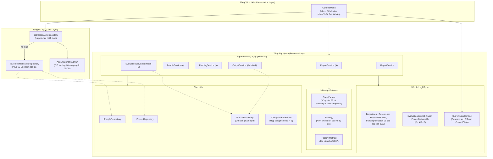
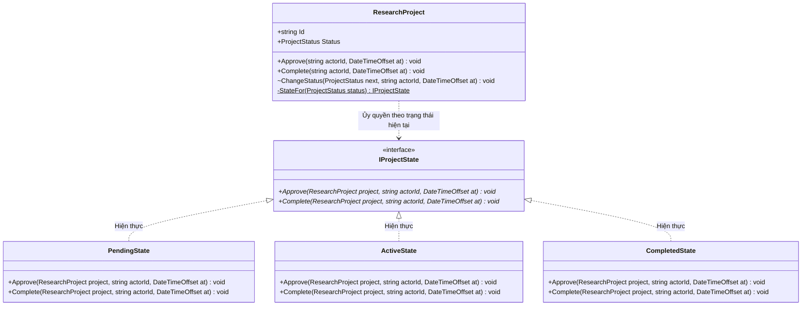
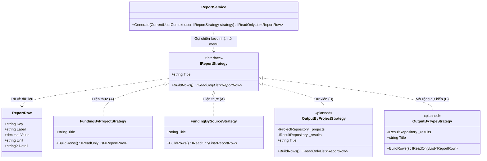
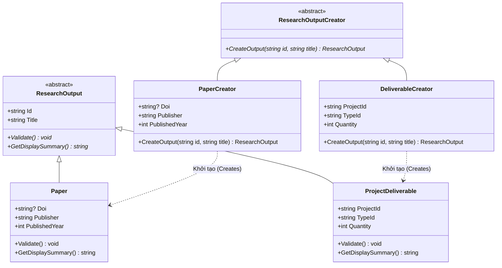
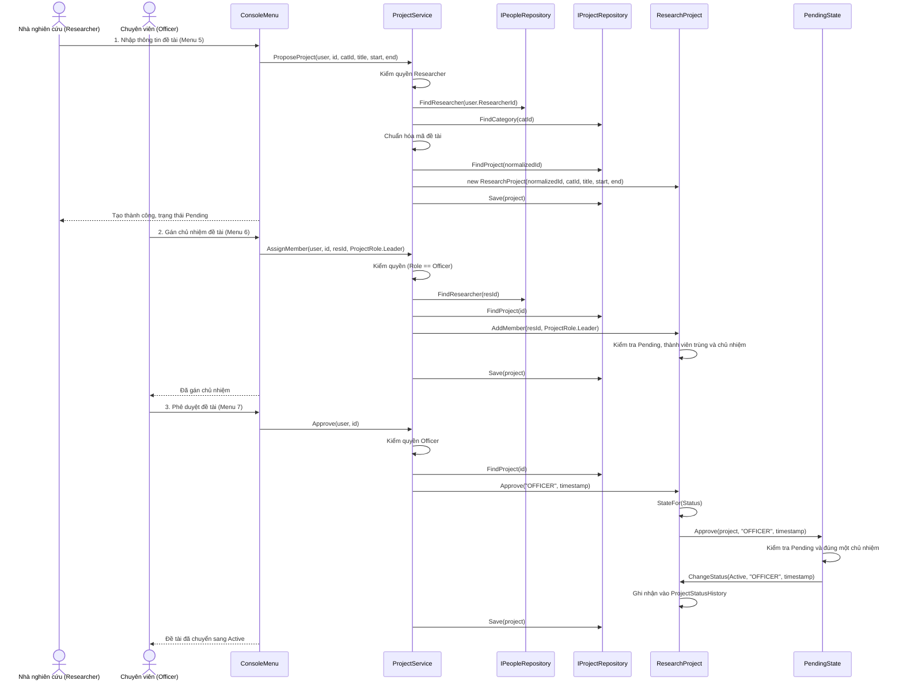
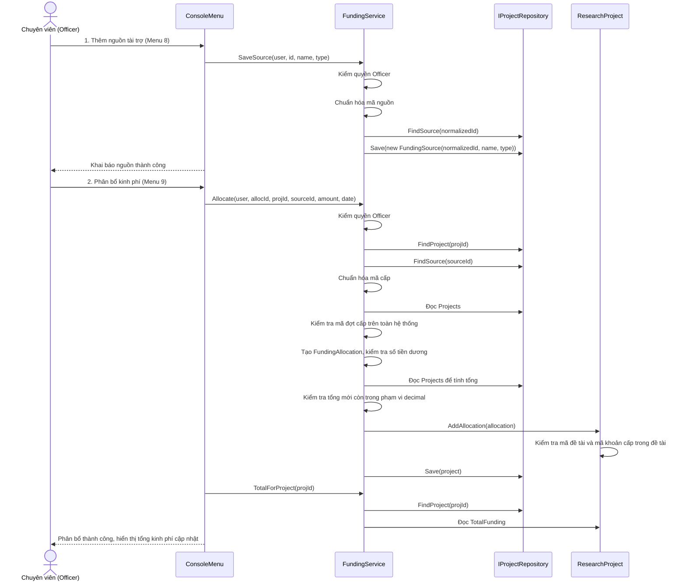
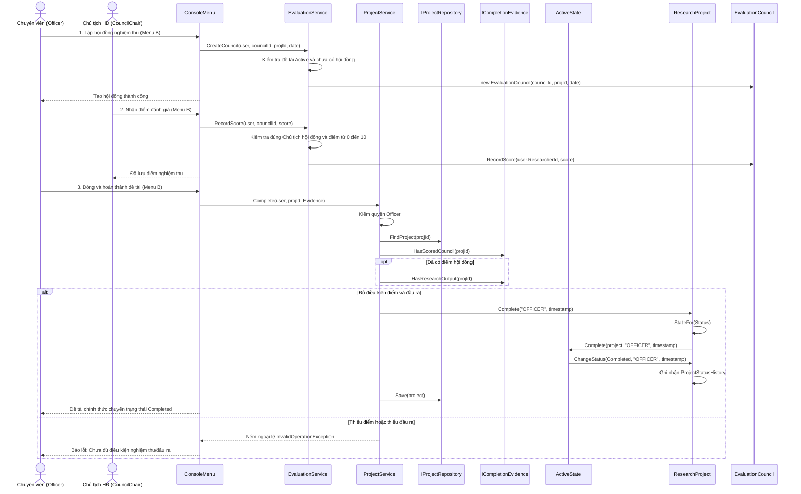
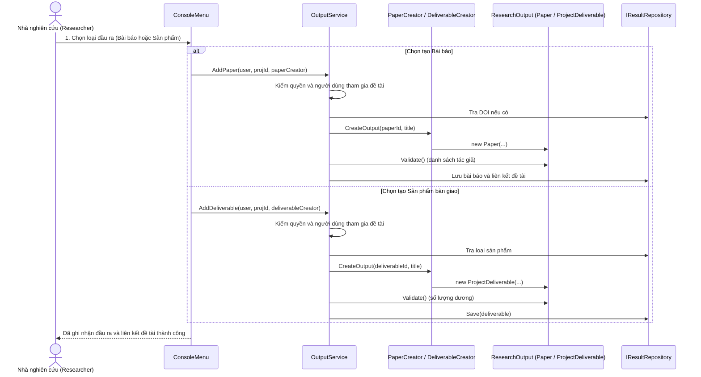

# Sơ đồ UML hệ thống quản lý nghiên cứu khoa học ở đại học

## 1. Kiến trúc ba tầng

Các sơ đồ về nhân sự, đề tài, cấp kinh phí và hai báo cáo kinh phí mô tả mã hiện tại. Hội đồng, đầu ra nghiên cứu, Strategy về đầu ra và Factory Method thuộc thiết kế tích hợp. Xem [đặc tả nghiệp vụ](scope.md) và [README](../README.md).

Chương trình C# gồm ba tầng trong cùng project.

- **Presentation.** `ConsoleMenu` nhận lựa chọn và dữ liệu nhập, giữ vai trò hiện tại, gọi service và hiển thị kết quả hoặc lỗi. Menu khởi tạo kho JSON để đưa vào các service.
- **Business.** Chứa mô hình, service, các giao diện và `CurrentUserContext`. Xử lý quy tắc nghiệp vụ mà không đọc hoặc ghi console, tệp dữ liệu.
- **Data.** `InMemoryResearchRepository` hiện thực hai giao diện kho. `JsonResearchRepository` kế thừa lớp này và ghi đè `Save` để ghi `data/nckh.json`. Bộ kiểm thử dùng kho trong bộ nhớ.

---

## 2. Sơ đồ lớp nghiệp vụ

Thiết kế tổng thể có 16 kiểu nghiệp vụ cụ thể, gồm 9 kiểu trong mã hiện tại và 7 kiểu dự kiến cho nghiệm thu và đầu ra. `ProjectStatusHistory` nằm trong nhóm 9 kiểu của A. `ResearchOutput` là lớp trừu tượng dự kiến cho phần đầu ra.

### Các kiểu nghiệp vụ
1. **Dữ liệu nền**: `Department`, `Researcher`, `DepartmentHeadTerm`, `ProjectCategory`
2. **Đề tài**: `ResearchProject`, `ProjectParticipation`, `ProjectStatusHistory`
3. **Kinh phí**: `FundingSource`, `FundingAllocation`
4. **Nghiệm thu**: `EvaluationCouncil`, `CouncilMembership`
5. **Đầu ra**: `DeliverableType`, `ProjectDeliverable`, `Paper`, `PaperAuthor`, `ProjectPaperLink`

```mermaid
classDiagram
    %% Lớp cơ sở trừu tượng
    class ResearchOutput {
        <<abstract>>
        +string Id
        +string Title
        +Validate()* void
        +GetDisplaySummary()* string
    }

    %% Dữ liệu nền và nhân sự (A)
    class Department {
        +string Id
        +string Name
        +DateOnly CreatedAt
        +Rename(string name) void
    }

    class Researcher {
        +string Id
        +string DepartmentId
        +string FullName
        +string Email
        +string? AcademicTitle
        +string? Phone
        +string? Organization
        +bool IsInstructor
        +Update(...) void
    }

    class DepartmentHeadTerm {
        +string Id
        +string DepartmentId
        +string ResearcherId
        +DateOnly From
        +DateOnly? To
    }

    class ProjectCategory {
        +string Id
        +string Name
    }

    %% Đề tài và kinh phí (A)
    class ResearchProject {
        +string Id
        +string CategoryId
        +string Title
        +DateOnly StartDate
        +DateOnly? EndDate
        +ProjectStatus Status
        +IReadOnlyList~ProjectParticipation~ Members
        +IReadOnlyList~FundingAllocation~ Allocations
        +IReadOnlyList~ProjectStatusHistory~ History
        +decimal TotalFunding
        +AddMember(string researcherId, ProjectRole role) void
        +AddAllocation(FundingAllocation allocation) void
        +Approve(string actorId, DateTimeOffset at) void
        +Complete(string actorId, DateTimeOffset at) void
        ~ChangeStatus(ProjectStatus next, string actorId, DateTimeOffset at) void
    }

    class ProjectParticipation {
        +string ProjectId
        +string ResearcherId
        +ProjectRole Role
    }

    class ProjectStatusHistory {
        +string ProjectId
        +ProjectStatus FromStatus
        +ProjectStatus ToStatus
        +DateTimeOffset ChangedAt
        +string ActorId
    }

    class FundingSource {
        +string Id
        +string Name
        +string Type
    }

    class FundingAllocation {
        +string Id
        +string ProjectId
        +string SourceId
        +decimal Amount
        +DateOnly AllocatedAt
    }

    %% Nghiệm thu (dự kiến B)
    class EvaluationCouncil {
        +string Id
        +string ProjectId
        +DateOnly EvaluationDate
        +decimal? Score
        +IReadOnlyList~CouncilMembership~ Members
        +AddMember(string researcherId, CouncilRole role) void
        +RecordScore(string actorResearcherId, decimal score) void
    }

    class CouncilMembership {
        +string CouncilId
        +string ResearcherId
        +CouncilRole Role
    }

    %% Đầu ra nghiên cứu (dự kiến B)
    class DeliverableType {
        +string Id
        +string Name
    }

    class ProjectDeliverable {
        +string ProjectId
        +string TypeId
        +int Quantity
        +Validate() void
        +GetDisplaySummary() string
    }

    class Paper {
        +string? Doi
        +string Publisher
        +int PublishedYear
        +IReadOnlyList~PaperAuthor~ Authors
        +AddAuthor(string researcherId, int order, bool isCorresponding) void
        +Validate() void
        +GetDisplaySummary() string
    }

    class PaperAuthor {
        +string PaperId
        +string ResearcherId
        +int AuthorOrder
        +bool IsCorresponding
    }

    class ProjectPaperLink {
        +string ProjectId
        +string PaperId
    }

    %% Quan hệ Kế thừa (Inheritance)
    ResearchOutput <|-- ProjectDeliverable : Kế thừa (Generalization)
    ResearchOutput <|-- Paper : Kế thừa (Generalization)

    %% Liên kết qua mã và quan hệ sở hữu danh sách
    Department "1" <-- "0..*" Researcher : Trực thuộc
    Department "1" <-- "0..*" DepartmentHeadTerm : Lịch sử nhiệm kỳ
    Researcher "1" <-- "0..*" DepartmentHeadTerm : Lãnh đạo

    ProjectCategory "1" <-- "0..*" ResearchProject : Thuộc loại

    ResearchProject "1" *-- "0..*" ProjectParticipation : Danh sách thành viên
    ResearchProject "1" *-- "0..*" ProjectStatusHistory : Lịch sử trạng thái
    ResearchProject "1" <-- "0..*" FundingAllocation : Các đợt cấp tiền

    Researcher "1" <-- "0..*" ProjectParticipation : Đảm nhiệm vai trò
    FundingSource "1" <-- "0..*" FundingAllocation : Nguồn cấp tiền

    %% Quan hệ Nghiệm thu
    ResearchProject "1" <-- "0..1" EvaluationCouncil : Tối đa 1 hội đồng
    EvaluationCouncil "1" *-- "1..*" CouncilMembership : Thành viên hội đồng
    Researcher "1" <-- "0..*" CouncilMembership : Tham gia hội đồng

    %% Quan hệ Đầu ra
    ResearchProject "1" o-- "0..*" ProjectDeliverable : Gắn trực tiếp đề tài
    DeliverableType "1" <-- "0..*" ProjectDeliverable : Phân loại sản phẩm

    Paper "1" *-- "1..*" PaperAuthor : Tác giả bài báo
    Researcher "1" <-- "0..*" PaperAuthor : Là tác giả

    ResearchProject "1" <-- "0..*" ProjectPaperLink : Liên kết
    Paper "1" <-- "0..*" ProjectPaperLink : Liên kết
```

---

## 3. Mẫu thiết kế

- **Thành viên A.** State cho vòng đời đề tài và hai Strategy tổng hợp kinh phí.
- **Thành viên B.** Factory Method và Strategy về đầu ra trong thiết kế tích hợp.

### 3.1. State cho vòng đời đề tài
- `ResearchProject.StateFor` chọn State theo trạng thái hiện tại. `PendingState` duyệt đề tài đang chờ có đúng một chủ nhiệm, `ActiveState` hoàn thành đề tài đang thực hiện, còn `CompletedState` từ chối cả hai thao tác.
- Khi thêm trạng thái, cần bổ sung lớp State, cập nhật `ProjectStatus`, `StateFor` và quy tắc phục hồi lịch sử từ JSON.

### 3.2. Strategy cho báo cáo
- Hai báo cáo kinh phí dùng chung `IReportStrategy` và kiểu dòng `ReportRow`. `ReportService.Generate` kiểm quyền chuyên viên rồi gọi `BuildRows()` của Strategy được menu chọn.
- **Đã cài đặt ở phần A**
  - `FundingByProjectStrategy`: Tổng hợp kinh phí theo từng đề tài.
  - `FundingBySourceStrategy`: Nhóm các đợt cấp theo nguồn và cộng tiền cho từng nhóm. Nguồn chưa cấp kinh phí không xuất hiện trong bảng.
- **Dự kiến ở phần B**
  - `OutputByProjectStrategy`: Thống kê số lượng bài báo, sản phẩm theo từng đề tài.
  - `OutputByTypeStrategy`: Thống kê sản phẩm nghiên cứu theo chủng loại (Mở rộng).

### 3.3. Factory Method cho UC07 — thiết kế tích hợp của B

`ResearchOutputCreator` khai báo `CreateOutput(id, title)`. Hai lớp con ghi đè phương thức để tạo `Paper` hoặc `ProjectDeliverable`. Đầu ra kiểm tra dữ liệu của chính nó. Các điều kiện cần tra kho, như DOI trùng hoặc mã loại sản phẩm không tồn tại, thuộc trách nhiệm của service.

---

## 4. Service và giao diện kho dữ liệu

Service nhận giao diện thay vì tạo kho cụ thể. Sơ đồ ghi các phương thức chính. `IResultRepository`, `EvaluationService` và `OutputService` là phần dự kiến tích hợp. `ProjectService.Complete` nhận `ICompletionEvidence` từ bên gọi. Bộ kiểm thử A dùng một đối tượng giả lập giao diện này.

```mermaid
classDiagram
    %% Repositories
    class IPeopleRepository {
        <<interface>>
        +FindDepartment(string id) Department?
        +FindResearcher(string id) Researcher?
        +IReadOnlyCollection~Researcher~ Researchers
        +IReadOnlyCollection~DepartmentHeadTerm~ HeadTerms
        +Save(Department department) void
        +Save(Researcher researcher) void
    }

    class IProjectRepository {
        <<interface>>
        +FindCategory(string id) ProjectCategory?
        +FindProject(string id) ResearchProject?
        +FindSource(string id) FundingSource?
        +IReadOnlyCollection~ResearchProject~ Projects
        +Save(ResearchProject project) void
        +Save(FundingSource source) void
    }

    class IResultRepository {
        <<interface>>
        +FindCouncil(string id) EvaluationCouncil
        +FindCouncilByProject(string projectId) EvaluationCouncil
        +FindPaper(string id) Paper
        +FindDeliverablesByProject(string projectId) IReadOnlyCollection~ProjectDeliverable~
        +Save(EvaluationCouncil council) void
        +Save(Paper paper) void
        +Save(ProjectDeliverable deliverable) void
    }

    class ICompletionEvidence {
        <<interface>>
        +HasScoredCouncil(string projectId) bool
        +HasResearchOutput(string projectId) bool
    }

    %% Services
    class PeopleService {
        +SaveDepartment(CurrentUserContext user, string id, string name, DateOnly createdAt) Department
        +SaveResearcher(CurrentUserContext user, string id, string departmentId, string fullName, string email, ...) Researcher
        +GetHeadHistory(CurrentUserContext user, string departmentId) IReadOnlyList~DepartmentHeadTerm~
    }

    class ProjectService {
        +ProposeProject(CurrentUserContext user, string id, string categoryId, string title, DateOnly startDate, DateOnly? endDate) ResearchProject
        +AssignMember(CurrentUserContext user, string projectId, string researcherId, ProjectRole role) void
        +Approve(CurrentUserContext user, string projectId) void
        +Complete(CurrentUserContext user, string projectId, ICompletionEvidence evidence) void
    }

    class FundingService {
        +SaveSource(CurrentUserContext user, string id, string name, string type) FundingSource
        +Allocate(CurrentUserContext user, string id, string projectId, string sourceId, decimal amount, DateOnly allocatedAt) FundingAllocation
        +TotalForProject(string projectId) decimal
    }

    class EvaluationService {
        -IProjectRepository _projects
        -IPeopleRepository _people
        -IResultRepository _results
        +CreateCouncil(CurrentUserContext user, string councilId, string projectId, DateOnly date) void
        +AssignMember(CurrentUserContext user, string councilId, string researcherId, CouncilRole role) void
        +RecordScore(CurrentUserContext user, string councilId, decimal score) void
    }

    class OutputService {
        -IProjectRepository _projects
        -IResultRepository _results
        +AddPaper(CurrentUserContext user, string projectId, PaperCreator creator) void
        +AddDeliverable(CurrentUserContext user, string projectId, DeliverableCreator creator) void
    }

    class ReportService {
        +Generate(CurrentUserContext user, IReportStrategy strategy) IReadOnlyList~ReportRow~
    }

    class InMemoryResearchRepository {
        +Save(Department value) void
        +Save(Researcher value) void
        +Save(ResearchProject value) void
        +Save(FundingSource value) void
    }

    class JsonResearchRepository {
        -string _dataPath
        -Load(AppSnapshot snapshot) void
        -Persist() void
    }

    %% Relationships
    PeopleService --> IPeopleRepository
    ProjectService --> IPeopleRepository
    ProjectService --> IProjectRepository
    ProjectService ..> ICompletionEvidence : Kiểm tra bằng chứng
    FundingService --> IProjectRepository
    EvaluationService ..> IProjectRepository : Dự kiến
    EvaluationService ..> IPeopleRepository : Dự kiến
    EvaluationService ..> IResultRepository : Dự kiến
    OutputService ..> IResultRepository : Dự kiến
    OutputService ..> IProjectRepository : Dự kiến
    ReportService ..> IReportStrategy

    InMemoryResearchRepository ..|> IPeopleRepository
    InMemoryResearchRepository ..|> IProjectRepository
    InMemoryResearchRepository <|-- JsonResearchRepository
```

---

## 5. Sơ đồ tuần tự

Bốn sơ đồ minh họa các luồng tiêu biểu. Hai sơ đồ đầu mô tả thao tác đang chạy của A. Hai sơ đồ sau mô tả cách B dự kiến tích hợp.

### 5.1. UC02–UC03 — Đề xuất, gán chủ nhiệm và duyệt
Thể hiện sự phối hợp giữa `ProjectService`, `ResearchProject`, `PendingState` và lưu vết vào `ProjectStatusHistory`.

### 5.2. UC04 — Khai báo nguồn và phân bổ kinh phí

Sơ đồ theo luồng thành công. Service từ chối mã trùng và kiểm tra tổng kinh phí trước khi thêm khoản cấp vào đề tài.

### 5.3. UC05–UC06 — Hội đồng và nghiệm thu dự kiến tích hợp

Chủ tịch hội đồng ghi điểm. Chuyên viên gọi `ProjectService.Complete` với bằng chứng lấy từ dữ liệu nghiệm thu và đầu ra. Nhánh hoàn thành minh họa đề tài đang `Active`.

### 5.4. UC07 — Ghi nhận đầu ra qua Factory Method dự kiến

Factory tạo đối tượng theo loại đầu ra. Service kiểm tra tham chiếu và các ràng buộc cần tra kho trước khi lưu.

